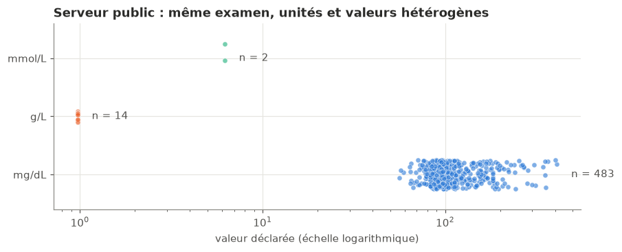
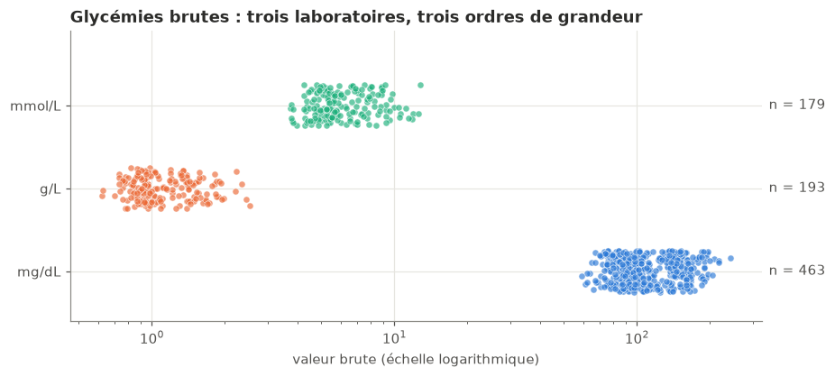
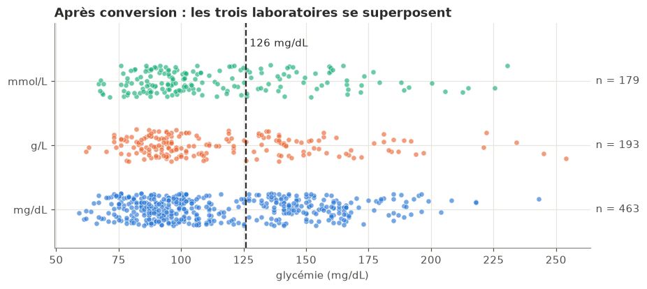
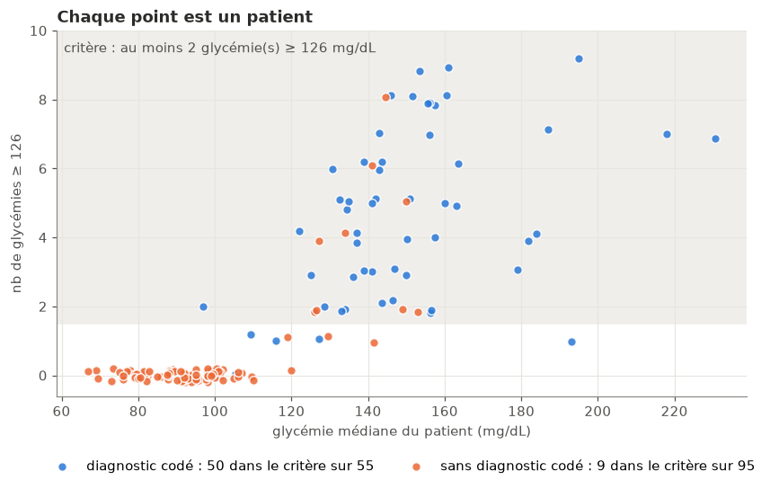
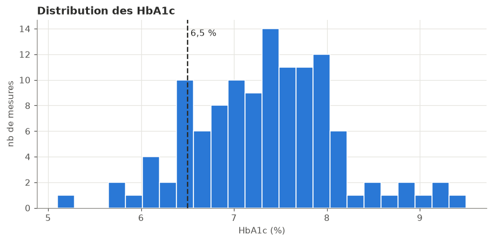
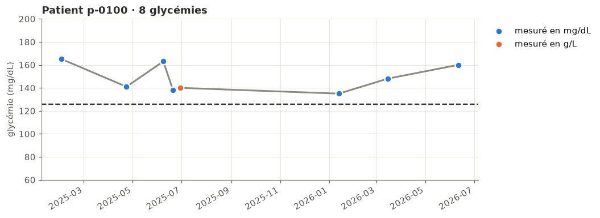
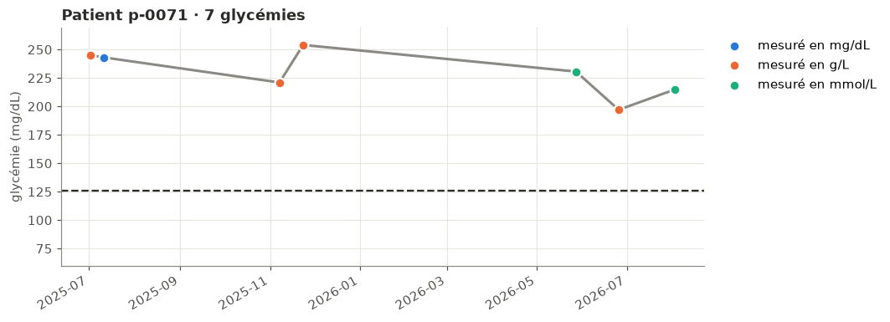

# Séance 1 · FHIR — d'un export FHIR à un mini-entrepôt OMOP

Projet réalisé dans le cadre du Master 2 Data Science en Santé (Université de Lille), séance 1 « FHIR, échanger les données de santé ».
Il montre comment passer d'un export FHIR (NDJSON) à des tables OMOP (`PERSON`, `MEASUREMENT`) avec DuckDB, en harmonisant les unités des glycémies, puis comment répondre à une question clinique à partir de ces tables.


## Le pipeline du TP 2

1. **Explorer** l'export : trois laboratoires, trois unités (mg/dL, g/L, mmol/L), des HbA1c et des mesures `cancelled` ou `entered-in-error`.
2. **Harmoniser** dans `stg_glycemie` : on garde les statuts `final`, les LOINC 2345-7 et 14749-6 et les valeurs positives, puis on convertit en mg/dL (g/L × 100 ; mmol/L × 18,016) en gardant la valeur, l'unité et le code d'origine.
3. **Mapper** vers OMOP : `person` (concepts de genre 8507 et 8532) et `measurement` (concept 3004501, unité 8840, type 32817).
4. **Interroger** : au moins 2 glycémies ≥ 126 mg/dL, croisées avec les diagnostics (SNOMED 44054006).

## Résultats principaux

| Questions | Réponses |
|---|---|
| Observations de l'export | 984 (463 glycémies en mg/dL, 193 en g/L, 179 en mmol/L, 117 HbA1c, 32 mesures annulées ou saisies par erreur) |
| Glycémies exploitables après nettoyage | 835 |
| Patients avec ≥ 2 glycémies ≥ 126 mg/dL | 59, dont 9 sans diagnostic codé |
| Même critère avec un seuil à 110 mg/dL | 70 patients, dont 17 sans diagnostic |
| Glycémies ≥ 126 mg/dL qui auraient échappé sans conversion | 41,2 % (119 sur 289) |
| Patients avec HbA1c ≥ 6,5 % | 53, aucun sans diagnostic codé |
| Patient à la glycémie maximale | p-0071 (254 mg/dL) |

## Figures

### 1. Pourquoi harmoniser : même examen, unités différentes

Sur le serveur public HAPI, une même glycémie est déclarée dans des unités différentes : sur 499 mesures récupérées le 12 novembre 2026, 483 sont en mg/dL, 14 en g/L et 2 en mmol/L. Les ordres de grandeur vont de 1 à plus de 100, donc une moyenne directe n'aurait aucun sens.



### 2. Les glycémies de l'export avant et après conversion

Dans l'export fictif, les trois laboratoires s'expriment aussi dans trois unités. Après conversion en mg/dL, leurs distributions se superposent (moyennes de 114,2 à 115,9 mg/dL). Sans conversion, le seuil de 126 ignorerait toutes les valeurs en g/L et en mmol/L : c'est une erreur silencieuse.

| Avant conversion | Après conversion |
|---|---|
|  |  |

### 3. La carte des patients

Chaque point est un patient : en abscisse sa glycémie médiane, en ordonnée le nombre de ses glycémies ≥ 126 mg/dL. La zone grisée correspond au critère (au moins 2). 50 des 55 patients avec un diagnostic codé entrent dans le critère, ainsi que 9 des 95 patients sans diagnostic codé : ce sont les cas à signaler au médecin traitant.



### 4. HbA1c : qui dose-t-on ?

Seuls les 55 patients déjà diagnostiqués ont une HbA1c (117 mesures, de 5,1 à 9,5 %) ; aucun des 95 autres n'en a. Les 53 patients à 6,5 % ou plus ont donc tous un diagnostic codé.



### 5. Deux courbes de patients

| Au critère, sans diagnostic codé (p-0100) | Glycémie maximale (p-0071, 254 mg/dL) |
|---|---|
|  |  |

## Installation de l'environnement

```bash
cd <dossier-du-projet>
python -m venv .venv
source .venv/bin/activate        # Windows : .venv\Scripts\activate
pip install -r requirements.txt
jupyter notebook seance1_etudiant.ipynb
```

## Technologies

Python 3.14 · Jupyter · DuckDB · pandas · matplotlib · `fhir.resources` · `fhirpathpy` · `requests` · `ipywidgets`

## Réalisé par

Hippolyte ADECHIAN

## Formation :

Master 2 Data Science en Santé, Université de Lille

## Cours :

Data Management

## Enseignant :

Antoine Teston (antoine.teston@univ-lille.fr)